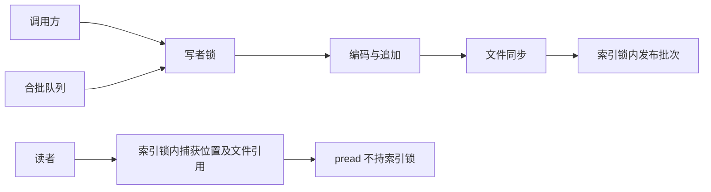

# 设计与并发边界

作者：gy

## 数据如何成为“已提交”

文件只追加。一个批次由固定头、操作正文和提交尾组成。恢复时先校验固定头，再相信其中的长度，读正文和提交尾；所有校验通过，才更新索引。
内存索引保存 key 对应的文件描述符、偏移、长度、revision 和 expiration，不缓存全部 value，也不保存全部历史帧摘要。

正常写入先取得写者锁，编码和追加文件，按配置同步，最后在索引锁内一次发布整个批次。
读者在索引锁内取得旧位置和文件引用，然后释放锁，调用 `pread`。写者写到一半或正在同步时，读者仍能读旧的完整值。
IO 失败后不会把不确定的索引发布给新读者；已捕获旧位置的读取可以完成。

索引锁还保护实例状态、时间钳制和统计。枚举、TTL 过滤及字典 CoW 可能产生 O(key 数) 工作，因此“文件 IO 不持索引锁”不等于所有读延迟恒定。
`@unchecked Sendable` 的依据是这套同步约定，不是声明后自动获得线程安全。可注入时钟必须线程安全且不重入 store；故障回调只用于实验，不得重入修改状态。

## 文件清单是恢复入口

没有清单的旧目录按单个 `store.log` 读取。验证成功后发布首份 `manifest.json`。
后续恢复只读取清单引用的文件，拒绝重复文件名、路径穿越、校验失败和序列不连续。不会靠扫描目录猜测哪个文件“最新”。

轮转顺序是：同步旧活动段 → 建立新段及头部 → 同步新段和目录 → 发布新清单并同步目录 → 允许在新段写入。
新清单发布前退出，新段是孤儿；发布后退出，新段是有效的空活动段。两种情况下旧数据都还存在。
只有最后一个活动段允许按策略修剪不完整尾部；封存段出现尾部缺失必须报错。

清单通过临时文件、文件同步、原子 rename、目录同步发布。CRC 负责发现意外损坏，不提供防恶意篡改能力。

## 后台压缩

1. 写者锁内捕获活跃索引、提交高水位和旧段列表，再轮转一个增量段。
2. 释放写者锁，将捕获的数据写成 checkpoint。读写继续进行，新提交进入增量段。
3. checkpoint 同步完成后重新取得写者锁，发布“checkpoint + 所有增量段”的清单。
4. 内存索引只替换仍指向旧段的位置。已被更新或删除的 key 保持当前状态。
5. 清单已持久化后才 unlink 旧路径。读取和快照持有的文件描述符继续有效。

checkpoint 保持捕获时的提交高水位和各 key 的 revision。写 checkpoint 不消费业务提交序号，否则压缩产生的帧数会与并发增量提交相撞。
发布阶段用已有帧数和字节计数计算新统计，不重新扫描所有增量段，减少写入暂停。索引替换本身仍是 O(key 数)。
同一实例只允许一个压缩任务。取消在捕获前、构建期间和发布前检查；发布临界区开始后完成切换，取消不撤销已发布结果。
`close()` 可以先返回，后台任务会在发布前看到 closed；任务暂时保留目录锁直到退出，避免另一个实例接管时旧任务仍在工作。
进度回调在锁外执行，可读取或写入，但应保持简短。旧文件清理失败会在 `CompactionReport.cleanupFailures` 返回，不影响已发布数据的权威性。

## 合批与背压

`GroupedWriter` 在接纳时限制请求数量和正文总字节。拒绝请求返回 `queueFull`，不会静默丢弃。
串行队列按照接纳顺序拼接操作，受最大组请求数、16 MiB/4096 操作和延迟窗口约束。
一次写入成功后整组确认；同步模式下多个请求共享一次日志同步。组内同 key 的后一个操作生效，整个组共享一个 revision。
请求验证错误单独返回，不能拖坏已接纳请求；IO 错误则整组失败，并让所有等待者结束。

异步方法在接纳前检查取消；接纳后不撤销，以免调用方误判“取消就一定没写”。`flush/close` 是队列屏障，排空此前已接纳请求后同步。
排队容量不包含调用方自己持有的数据及提交前的编码验证缓冲；它不是进程内存硬上限。延迟窗口也不是系统繁忙时的绝对时限。

## 成本与取舍

| 行为 | 主要成本或约束 |
|---|---|
| 打开 | 扫描清单内所有有效历史；每次读取一个有界帧，索引 O(key 数) |
| 读取 | 短索引锁 + 一次 pread；不引入额外 value 缓存 |
| 快照 | 保留索引与描述符；创建时过滤/排序，后续写入可能触发字典 CoW |
| 压缩 | 额外写一份当前活跃数据；磁盘需有临时空间，发布时替换索引 |
| 备份 | 取得写者锁复制清单引用文件，期间阻塞新写入，读取仍可继续 |
| 恢复备份 | 验证后复制并发布到新目录；源备份应保持不变 |
| 诊断 | inspect/verify 只读、不持目录租约；对正在轮转/压缩的目录不保证一致视图，宜离线检查 |

选择这套结构是为了让恢复与发布边界可阅读、可测试。没有实现多进程事务、加密、零拷贝 mmap、磁盘 B+Tree 或 LSM 多层合并；当前索引仍需装入内存。
